# claude-dojo

[](LICENSE)


[](CONTRIBUTING.md)


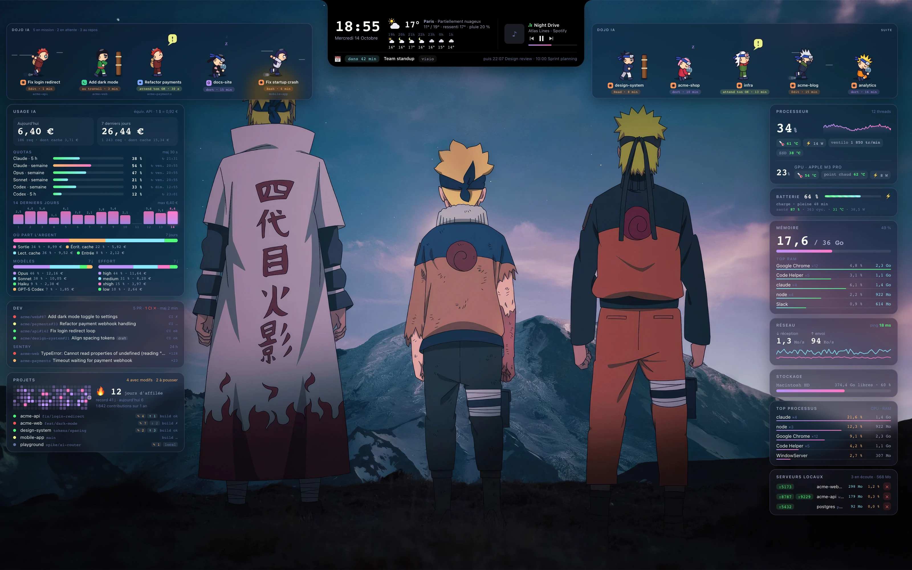

An animated macOS desktop wallpaper that shows every active Claude Code session as a ninja, surrounded by live panels for your system, GitHub, local projects, AI usage and quotas.

## Install

### 1. Get the app

1. Download `ClaudeDojo-<version>.dmg` from the [Releases page](https://github.com/gtko/claude-dojo/releases).
2. Open the disk image and drag **DojoWallpaper.app** into **Applications**.

### 2. Open it for the first time

The app is ad hoc signed but not notarized by Apple, so Gatekeeper blocks its first launch. Use one of these two ways:

- Open **System Settings › Privacy & Security**, click **Open Anyway** (« Ouvrir quand même ») next to the message about DojoWallpaper, and confirm.
- Or run this in Terminal:

  ```sh
  xattr -dr com.apple.quarantine /Applications/DojoWallpaper.app
  ```

Then open DojoWallpaper from Applications. On the first launch, the setup assistant opens.

### 3. Follow the setup assistant

The assistant has eleven steps. Steps 3 to 6 are optional, and nothing is changed until you click **Apply** on the last step.

1. **Welcome**: what the assistant sets up.
2. **Dependencies**: checks for Node.js 18 or later, which is required. `macmon` and `media-control` are optional, and missing ones can be installed with Homebrew from this step. `gh` is optional; it needs `gh auth login` in a terminal.
3. **Weather**: search for your city. Its coordinates and time zone are used for the forecast on the wallpaper.
4. **GitHub**: the accounts or organizations whose repositories Dojo follows.
5. **Projects**: the folders where Dojo looks for Git repositories. Leave it empty to use the usual locations.
6. **Calendars**: the ICS or webcal addresses of your calendars.
7. **Claude Code**: the hooks, the status line, and the optional heavy-gate and `VITEST_MAX_WORKERS` settings. The changes to `~/.claude/settings.json` are shown before anything is written.
8. **Automatic start**: starts Dojo at login. No administrator rights are needed.
9. **Thème**: the [theme](#themes) and the background of the wallpaper. They are applied when you click **Apply**.
10. **Zone de travail**: the optional [window zone](#window-zone), off by default. It is applied when you click **Apply**.
11. **Done**: a summary of your choices. Click **Apply** to make the changes.

<p align="center">
  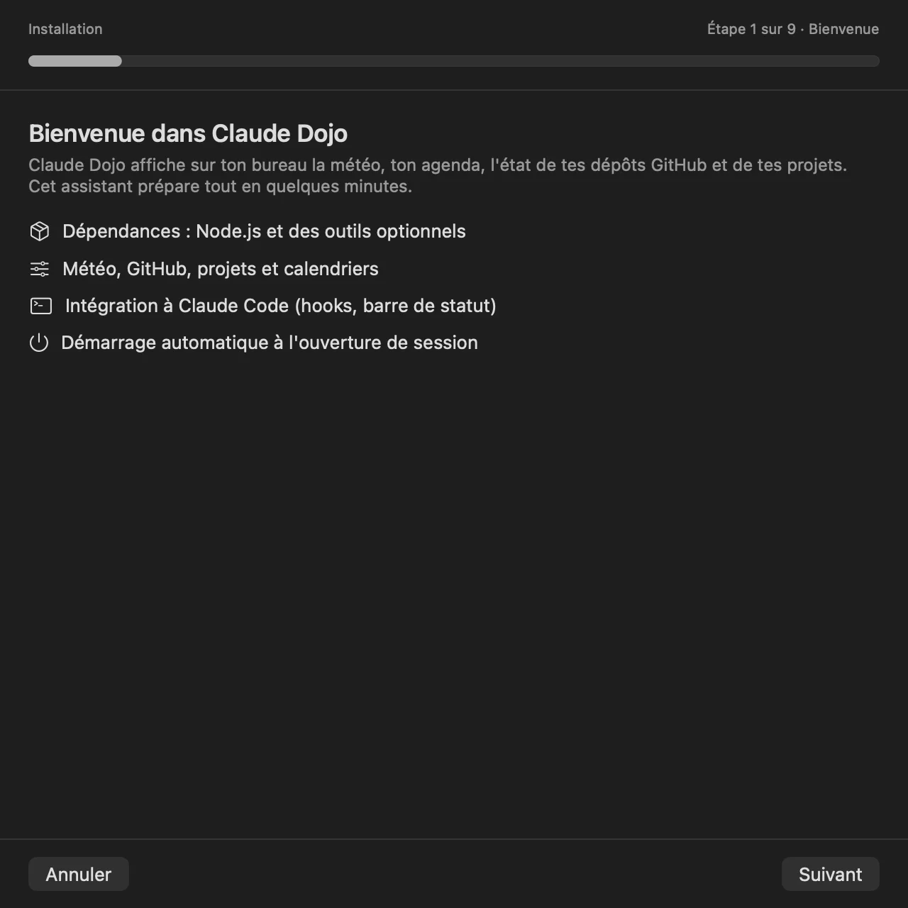
  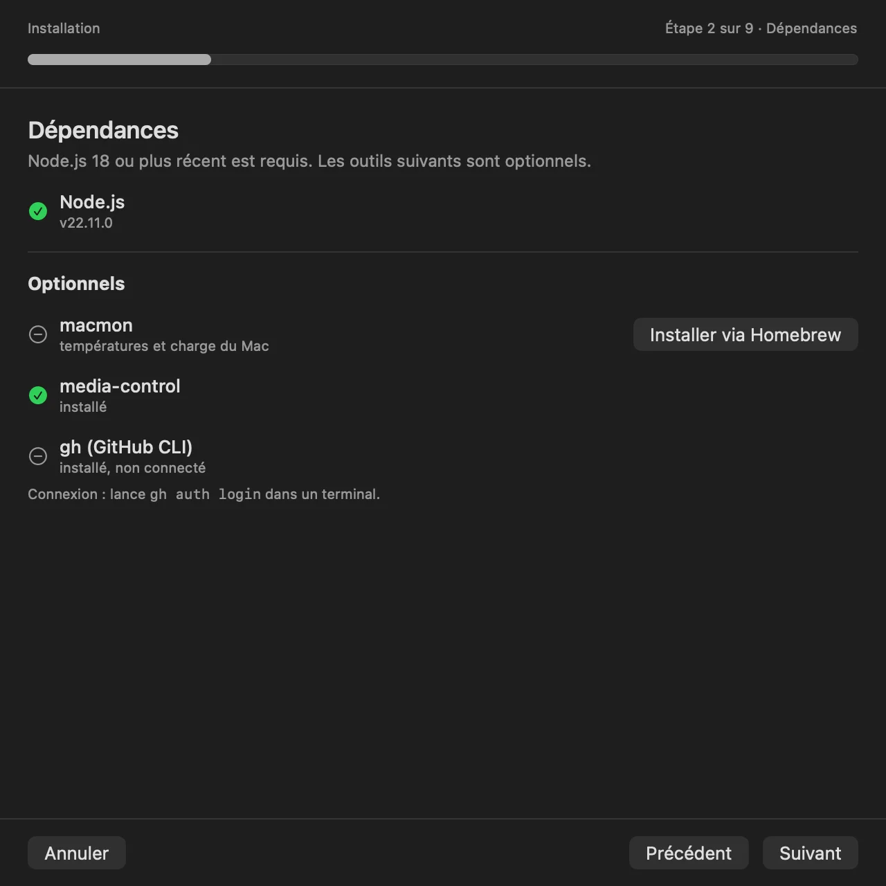
  <br>
  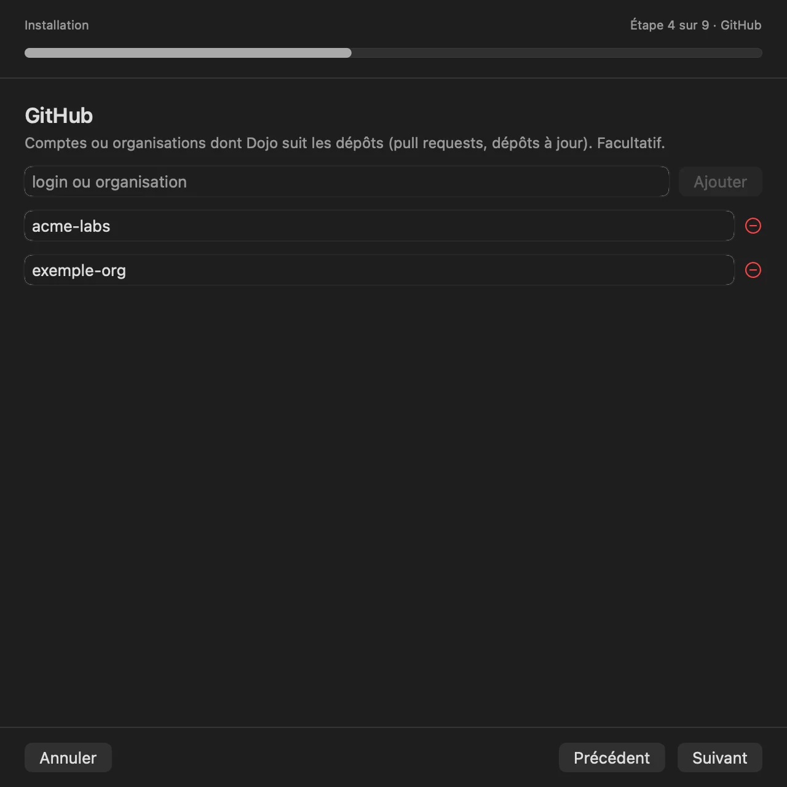
  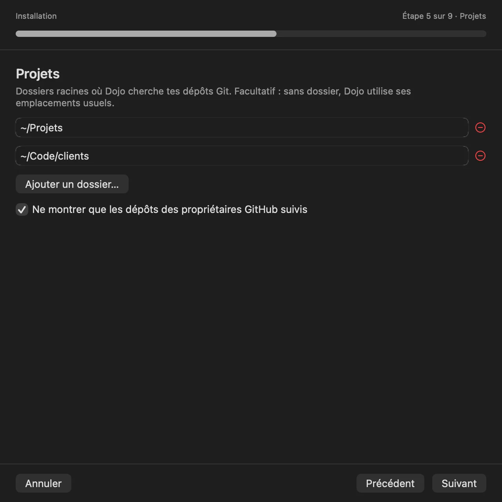
  <br>
  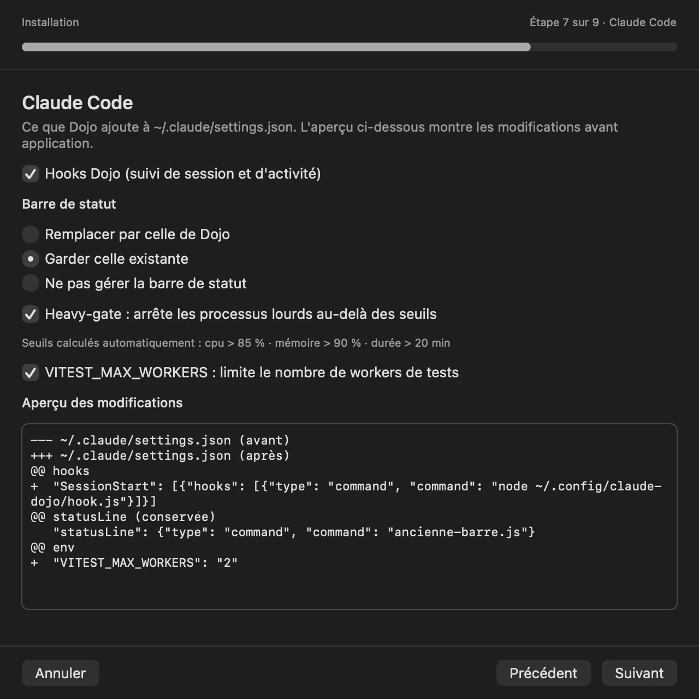
</p>

*Steps 1, 2, 4, 5 and 7 of the setup assistant, with sample data.*

### What the assistant changes

- `~/.config/claude-dojo/`: the Dojo files (including the `themes/` folder with the eight themes), the `config.json` file (mode `0600`, because it can contain private URLs), the cache, once you choose a custom background the `backgrounds/` folder, and, if you enable them, the [terminal parts](#terminal-themes): the `terminal/` folder, plus lines in Ghostty's configuration and `~/.zshrc`.
- `~/Library/LaunchAgents/`: `io.github.claude-dojo.agent` (local agent and collector) and `io.github.claude-dojo.wallpaper` (wallpaper app), which start at login.
- `~/.claude/settings.json`: the six Dojo hooks, the status line according to your choice (keep yours, replace it, or leave it alone), and, if you choose them, heavy-gate and `VITEST_MAX_WORKERS=2` in the `env` block, unless that variable is already set. `model`, `effort`, `plugins` and `permissions` are never touched. Before any change, the file is copied to `settings.json.bak-<timestamp>`.

**Keep DojoWallpaper.app where it is.** The LaunchAgent records the app's path when you apply the assistant (`/Applications` after a DMG install). If you move or delete the app, the automatic start stops working.

### Menu bar

The Dojo icon in the menu bar gives you the options listed in [Features](#features), plus:

- **Thème**: chooses one of the [themes](#themes), or a custom background (**Choisir un fond…**).
- **Fonds**, **Fond suivant** (⌘→) and **Fonds d'écran…**: switch wallpaper within the active theme, or browse the gallery. See [Wallpapers](#wallpapers).
- **Zone de travail**: the [window zone](#window-zone) checkbox, the Accessibility permission status, and the shortcuts' actions (**Agrandir dans la zone**, **Moitié gauche**, **Moitié droite**).
- **Réglages…** (⌘,): reopens the assistant to change your choices.
- **Désinstaller…**: removes Dojo. See [Uninstall](#uninstall).
- **Quitter le Dojo**: quits the app.

### From source (developers)

```sh
git clone https://github.com/gtko/claude-dojo.git && cd claude-dojo
./install.sh
```

The installer compiles the app into `~/Applications/DojoWallpaper.app` and asks the questions described in [What the installer does and asks](#what-the-installer-does-and-asks). Once it has finished, the Dojo runs from `~/.config/claude-dojo`, so the clone is not needed to run it. Keep the clone if you want to uninstall later, since `./uninstall.sh` is run from the repository.

To build the app and the DMG yourself:

```sh
./scripts/build-app.sh --version 1.0.0
```

This writes `dist/DojoWallpaper.app` (universal binary, minimum macOS 12.0) and `dist/ClaudeDojo-1.0.0.dmg`. `--no-dmg` builds only the app, `--out DIR` changes the output folder, and `--version` sets the version (the default is `git describe --tags --always`). The build needs the Xcode Command Line Tools and npm.

## Features

- **One ninja per Claude Code session**, with its state (working, waiting for your approval, idle). A click brings the matching terminal window forward.
- **System panels**: CPU, GPU, temperatures and power (with `macmon`), memory with the top processes, disks, network, battery, and local servers listening on your machine.
- **AI usage**: estimated cost in euros for today and the last 7 days, a 14-day chart, a breakdown by model and effort level, and your Claude and Codex quotas. Claude Code and Codex sessions are both read.
- **Dev panel**: open GitHub pull requests and their CI status, your contribution streak, and local Git repositories with uncommitted changes or unpushed commits.
- **Optional panels**: unresolved Sentry issues from the last 24 hours, a 3-day weather forecast, upcoming calendar events from ICS feeds, and the track currently playing.
- **Window zone** (optional, off by default): keeps the windows of your other apps out of the wallpaper panels, so the panels stay visible. See [Window zone](#window-zone).
- **Menu bar icon** to toggle interactive mode, reload the page, mirror the layout, change the size, choose a theme or a custom background (**Thème**), turn the window zone on or off (**Zone de travail**), open the assistant (Réglages…), uninstall, or quit.
- **Private by default**: the local agent listens on `127.0.0.1` only and rejects requests from other origins (protection against CSRF and DNS rebinding), so a web page open in your browser cannot read your data or trigger actions. Every panel that needs the network is optional.

**Language and artwork**: the wallpaper labels are in French for now, and each theme has its own. Pull requests that add translations (i18n) are welcome. The built-in artwork is original and drawn by code, except the Naruto background, which is third-party fan art included as a demo. The wallpaper gallery downloads third-party pictures from Wallhaven, see [Wallpapers](#wallpapers). To use your own picture, see [Use your own background](#use-your-own-background).

## Themes

The wallpaper has eight themes. A theme sets the background, the colour palette, the labels, the training object where your sessions work, and the characters that stand for them. The default theme is Naruto.

<p align="center">
  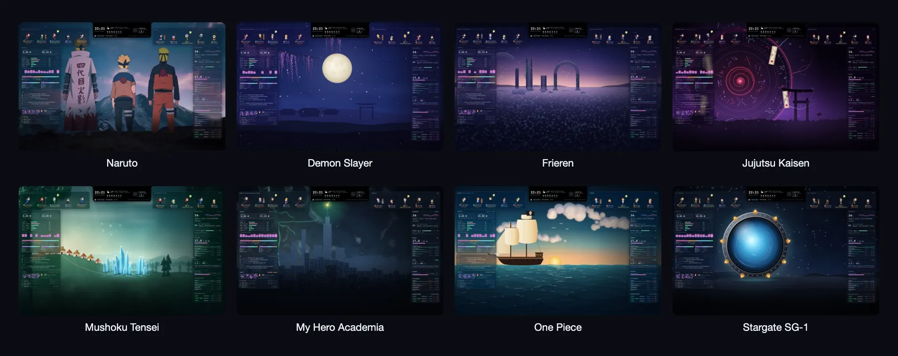
</p>

*The eight built-in themes.*

| Id | Theme | Characters | Credit |
|---|---|---|---|
| `naruto` (default) | Naruto | Naruto, Hinata, Sasuke, Sakura, Jiraiya, Kakashi, Rock Lee, Gaara, Itachi | Unofficial fan art, not affiliated |
| `stargate-sg1` | Stargate SG-1 | Jack O'Neill, Samantha Carter, Daniel Jackson, Teal'c, Général Hammond | Unofficial fan art, not affiliated |
| `demon-slayer` | Demon Slayer | Tanjiro Kamado, Nezuko Kamado, Zenitsu Agatsuma, Inosuke Hashibira, Kyojuro Rengoku | Unofficial fan art, not affiliated |
| `frieren` | Frieren | Frieren, Fern, Stark, Himmel, Heiter | Unofficial fan art, not affiliated |
| `one-piece` | One Piece | Luffy, Zoro, Nami, Sanji, Chopper | Unofficial fan art, not affiliated |
| `my-hero-academia` | My Hero Academia | Izuku Midoriya, Katsuki Bakugo, Shoto Todoroki, Ochaco Uraraka, All Might | Unofficial fan art, not affiliated |
| `jujutsu-kaisen` | Jujutsu Kaisen | Yuji Itadori, Megumi Fushiguro, Nobara Kugisaki, Satoru Gojo, Ryomen Sukuna | Unofficial fan art, not affiliated |
| `mushoku-tensei` | Mushoku Tensei | Rudeus Greyrat, Roxy Migurdia, Eris Boreas Greyrat, Sylphiette, Ruijerd Superdia | Unofficial fan art, not affiliated |

Each theme is unofficial fan art, not affiliated with the rights holders of its franchise. Naruto, Stargate SG-1, Demon Slayer, Frieren, One Piece, My Hero Academia, Jujutsu Kaisen and Mushoku Tensei are the property of their respective rights holders, who keep all rights. The illustrations contain no official artwork: they are original drawings generated by code (canvas and SVG). The one exception is the Naruto background, a third-party fan art image included as a demo, kept unchanged.

### Change the theme

- **Menu bar**: click the Dojo icon, choose **Thème**, then the theme you want.
- **Assistant**: open **Réglages…** (⌘,) and go to the **Thème** step.
- **Terminal**: `node ~/.config/claude-dojo/setup.js set-theme <id>`, for example `set-theme frieren`. To list the themes and the current choice as JSON, run `node ~/.config/claude-dojo/setup.js themes`.

The wallpaper applies the change live, without reloading the page.

### Use your own background

A custom image replaces the background of the current theme. The palette, labels and characters stay those of the theme.

- **Menu bar**: choose **Thème** › **Choisir un fond…**, then pick an image.
- **Terminal**: `node ~/.config/claude-dojo/setup.js set-background /path/to/image.jpg`

Accepted formats are JPG, JPEG, PNG, HEIC and WebP, up to 50 MB. The image is copied to `~/.config/claude-dojo/backgrounds/`, under a name built from its content, so you can move or delete the original. Replacing a background removes the previous copy from that folder. A file you chose from elsewhere is never deleted.

To go back to the theme's background, choose **Fond du thème** in the menu, or run `node ~/.config/claude-dojo/setup.js set-background default`. The choice is stored in the `background` key of [config.json](#configuration).

### Create a theme

A theme is data: a folder in `src/themes/`, named after its id. Ids use lowercase letters, digits and hyphens.

```
src/themes/<id>/
├── theme.json        palette, labels, training object and characters
├── background.jpg    2880 × 1800 pixels, 900 KB at most
└── thumbnail.jpg     preview, about 480 × 300 pixels
```

`theme.json` is plain JSON. The example below uses comments to explain each field; remove them in the real file. The `id` must match the folder name, and each character needs an `id` that is unique within the theme.

```jsonc
{
  "id": "stargate-sg1",                        // must match the folder name
  "name": "Stargate SG-1",                     // name shown in the menu and the assistant
  "credit": "Unofficial fan art, not affiliated with the rights holders of Stargate SG-1.",
  "accentFont": "\"Optima\", sans-serif",      // macOS system fonts only, or null: nothing is downloaded
  "palette": {                                 // CSS colours
    "bg": "rgba(14, 22, 34, .55)",             // translucent panel background, alpha .45 to .6
    "line": "rgba(214, 170, 90, .28)",         // panel border
    "fg": "#eef2f6",                           // main text, contrast of at least 4.5:1
    "muted": "#9fb3c8",                        // secondary text, contrast of at least 3:1
    "dim": "#5b7088",                          // tertiary text
    "purple": "#8fb4e0", "pink": "#6fd3f0",    // accent colours of bars and titles
    "orange": "#e0a84a", "yellow": "#f2d27a"
  },
  "vocab": {                                   // labels in the interface (French)
    "title": "SGC · ÉQUIPES SG",
    "empty": "Aucune équipe SG en mission — la base est calme.",
    "labelWorking": "en mission", "labelWaiting": "attend l'autorisation", "labelIdle": "dort",
    "summaryWorking": "en mission", "summaryWaiting": "en attente", "summaryIdle": "au repos"
  },
  "prop": "dhd",                               // training object: post, dhd, log, grimoire, barrel, robot, doll or staff
  "propColors": ["#a9825a", "#6fd3f0"],        // two colours for the training object
  "chars": [                                   // at least 5 characters
    {
      "id": "oneill",                          // unique within the theme: [a-z0-9-]+
      "name": "Jack O'Neill",
      "hair": "#c9ced6", "hairStyle": "short", // sprite fields, listed below
      "skin": "#f2c9a5", "skinD": "#dca57f",
      "top": "#4f5d3a", "topD": "#3b4730", "body": "#4f5d3a",
      "pants": "#4f5d3a", "pantsD": "#3b4730", "shoe": "#3a2e24",
      "iris": "#2f6fb0"
    }
    // four more characters
  ]
}
```

The first character is used for the first session, and the other sessions take the other characters in turn. The `bg` colour must be dark, because the panels are translucent on top of the background. The tests check the text contrast: `fg` at least 4.5:1 and `muted` at least 3:1, measured on the panel background over a dark backdrop.

Each character accepts these sprite fields. All are optional, and unknown fields are ignored:

| Group | Fields |
|---|---|
| Hair | `hair`, `hair2`, `hairStyle`: `spiky` (default), `long`, `duck`, `bob`, `kakashi`, `bowl`, `gaara`, `itachi`, `mane`, `short`, `messy`, `bald`, `twintail`, `curly`, `blast`, `split`, `antenna`, `flame`, `spikyUp`, `longStraight`, `pigtailOne` |
| Skin | `skin` (default `#ffd8b0`), `skinD` (default `#efb68b`) |
| Clothes | `top`, `topD`, `body`, `pants`, `pantsD`, `shoe` (default `#34406e`), `belt`, `band`, `scarf`, `cape`, `wrap` (leg bandage, `false` for none), `bare` (bare chest, where `top` is the skin colour), `flameCoat`, `checker` (`[c1, c2]`) |
| Face | `iris`, `brows`, `noBrow`, `noPupil`, `eyeRings`, `glasses`, `scarFace` (`forehead`, `cheek` or `eye`), `freckles`, `markings`, `paint`, `tear`, `scratch`, `whiskers`, `mask`, `boarMask`, `gag`, `eyeHidden`, `blindfold`, `gem`, `earrings`, `ears` (`elf`) |
| Head | `hat` (`straw`, `pink`, `witch` or `priest`), `hatBand`, `horn`, `antlers`, `ponytail`, `clouds`, `sennin` |
| Held or worn | `kanji`, `gourd`, `backItem` (`staff`, `swords`, `katana`, `spear` or `sheath`), `cigarette`, `tag` |

To add a theme, follow these steps:

1. **Background**: draw the scene in `scripts/themes/<id>/scene.html`. It is a self-contained page that sets `window.__ready = true` once it is drawn. Then run:

   ```sh
   node scripts/themes/render.cjs <id>
   ```

   It renders the page at 2880 × 1800 in headless Chrome and writes `src/themes/<id>/background.jpg`, lowering the JPEG quality until the file is at most 900 KB. It needs macOS (`sips`) and Chrome or Chromium; set `CHROME_PATH` if they are not found. `--png <path>` also keeps the intermediate PNG.
2. **Screenshots and thumbnail**: run `node scripts/screenshots.cjs --themes`. It captures each theme's page to `docs/screenshots/themes/<id>.webp`, writes the preview `src/themes/<id>/thumbnail.jpg` (480 × 300 pixels, except for Naruto, whose thumbnail is kept as it is), and builds the board `docs/screenshots/themes.webp` shown at the top of this section.
3. **Tests**: run `node --test test/`. The theme tests check the eight themes, the fields of each `theme.json`, the minimum of five characters, the size and format of each background, and the text contrast.

The installer and the assistant copy `src/themes/` to `~/.config/claude-dojo/themes/`, so run `./install.sh` again, or apply the assistant, to get a new theme. After you edit a theme's files, choose **Reload** in the menu bar icon.

## Wallpapers

<p align="center">
  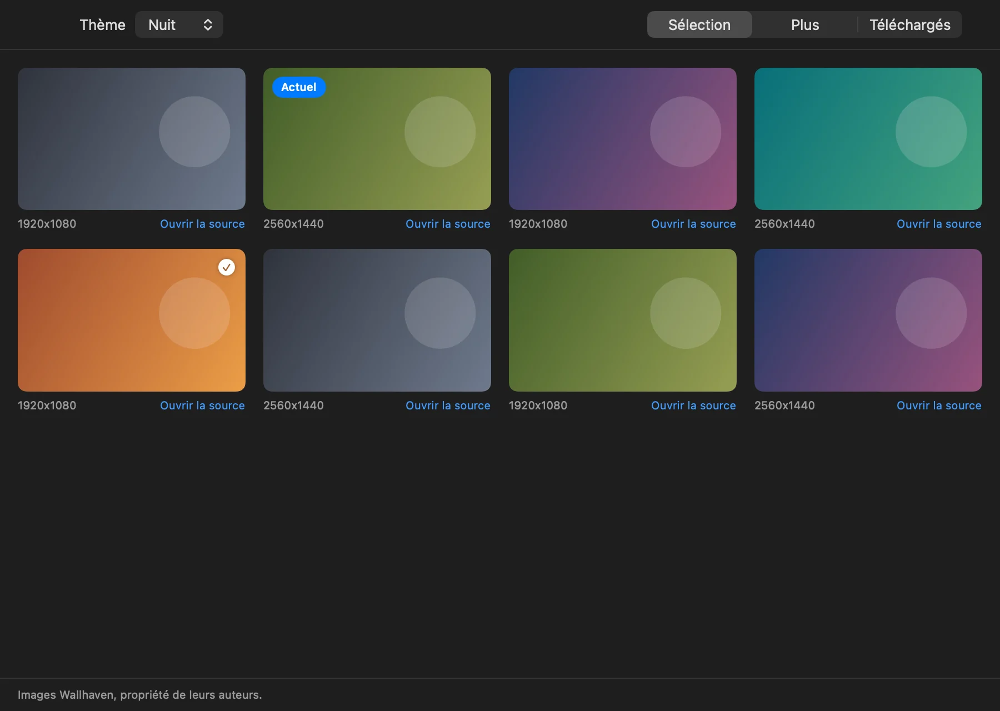
</p>

*The wallpaper gallery: real wallpapers from Wallhaven for the active theme.*

Each theme has a curated pack of wallpapers from [Wallhaven](https://wallhaven.cc). The repository stores only the Wallhaven ids of each pack, in the `wallpapers` field of `src/themes/<id>/theme.json`. The Wallhaven images themselves are not part of the repository or the DMG.

- **Safe for work only**: searches ask Wallhaven for SFW content only, and an image that is not SFW is refused.
- **The theme's own background stays available**: it is listed first for Naruto and last for the other themes.
- **Offline**: when Wallhaven cannot be reached, the download stops and what was already downloaded is kept. Without a downloaded wallpaper, the theme's own background is used.

### Automatic download

<p align="center">
  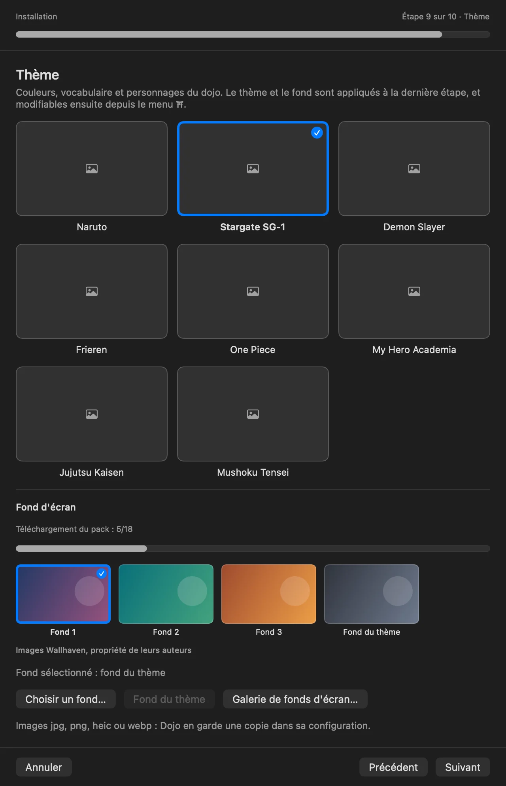
</p>

*The Theme step: the wallpaper strip of the active theme, with the download progress.*

- Unless `wallpapers.autoDownload` is `false` (see [Configuration](#configuration)), the pack of the active theme is downloaded in the background at launch and when you switch theme. Only the missing images are downloaded, and the theme's default wallpaper comes first.
- Requests are spaced one second apart.
- The progress is shown in the **Fonds** menu (for example `Téléchargement… 5/18`) and in the Theme step of the setup assistant. A failed download is reported there, in a short message.
- The default wallpaper is applied as soon as it is downloaded, if that theme is active, no background has been chosen for it, and the current background is not a picture you added yourself.
- To turn the automatic download off, set `wallpapers.autoDownload` to `false` in `config.json`. Switching theme then starts no download, and `wallpapers sync` without a theme does nothing. `wallpapers sync <theme>` still downloads a pack when you ask for it.

### Rights and sources

- These are third-party pictures from Wallhaven, not the original drawings included with each theme. They may show characters from the franchises of the themes, and claude-dojo is not affiliated with their rights holders.
- Each image belongs to its author, and the gallery footer says so. The images stay on your Mac, in `~/.config/claude-dojo/backgrounds/<theme>/`, readable by you only.
- The source of each image (its Wallhaven page, where the author is credited) is kept in `~/.config/claude-dojo/backgrounds/index.json`. **Ouvrir la source** opens that page in your browser.
- Check the author's terms on the source page before you use an image outside your desktop.

### Change the wallpaper

- **Menu bar, Fonds**: lists the wallpapers of the active theme, the theme's own background included. The one in use has a check mark, and clicking another one applies it.
- **Menu bar, Fond suivant** (⌘→): moves to the next wallpaper of the active theme, and starts again after the last one.
- **Menu bar, Fonds d'écran…**: opens the gallery window, with three tabs. **Sélection** shows the curated pack, **Plus** shows more Wallhaven results for the theme, page by page, and **Téléchargés** shows the wallpapers on your Mac. Clicking a thumbnail downloads the wallpaper if needed, then applies it.
- **Réglages…** (⌘,), Theme step, **Changer de fond automatiquement**: changes the wallpaper every 30 minutes, every hour, every day, or never. It uses the same list as Fond suivant. The setting is kept in the app's preferences, not in `config.json`.
- **Terminal**: `node ~/.config/claude-dojo/setup.js wallpapers <command>` prints JSON.

| Command | What it does |
|---|---|
| `list <theme>` | Shows the curated pack, with the details from Wallhaven |
| `search <theme> [page]` | Shows the Wallhaven results for the theme, page by page |
| `download <id> [theme]` | Downloads one wallpaper |
| `sync [theme]` | Downloads the missing images of the pack. Without a theme, does nothing when `wallpapers.autoDownload` is `false` |
| `progress <theme>` | Shows the progress of the current download |
| `use <id> [theme]` | Applies a downloaded wallpaper, by its Wallhaven id |
| `use <file>` | Applies a file from the gallery, or a picture of your own, which is copied as with `set-background` |
| `use theme` | Applies the theme's own background (`use bundled` does the same) |
| `next` | Applies the next wallpaper of the active theme |
| `local <theme>` | Lists the wallpapers on your Mac, the theme's own background included |

Each theme remembers its background in the `backgroundByTheme` key of [config.json](#configuration), so switching theme brings back the background you chose for it.

### Network

The gallery talks only to `wallhaven.cc` (search and API), `w.wallhaven.cc` (full images) and `th.wallhaven.cc` (thumbnails), over HTTPS. The requests are public: there is no account and no API key. They carry the theme's search terms, wallpaper ids and page numbers, and the header `User-Agent: claude-dojo/<version>`, which Wallhaven requires. Apart from these requests, which show your IP address to Wallhaven as any website does, nothing about you is sent. The full list is in [Outgoing network requests](#outgoing-network-requests).
## Window zone

The wallpaper panels sit behind your windows, so a maximized window hides them. The window zone is an option that keeps the windows of your other apps out of the panels, so they stay visible. It is **off by default**.

When it is on, Dojo measures the panels on each screen: the left column, the right column and, if you ask for it, the clock and weather band at the top. What remains is the free zone: one rectangle in the middle of each screen, plus a margin (8 pt by default). A standard window that overlaps a panel is moved into the free zone. It is made smaller only if it is larger than the zone, and never below the minimum size the app allows. Dojo waits until you stop moving a window (150 ms, and never while the mouse button is down) before it acts, so dragging a window is not fought.

What is never touched: windows of apps in native full screen, windows that cannot be resized, panels, dialogs and sheets, minimized windows, the Finder desktop, the windows of Dojo itself, and the apps in your exclusion list.

**Turn it on**: menu bar icon > **Zone de travail** > **Garder les fenêtres hors des panneaux**, or the **Zone de travail** step of **Réglages…**. The settings are:

| Setting (`windowZone` in `config.json`) | Purpose |
|---|---|
| `enabled` | `false` by default. Turns the window zone on |
| `margin` | Space in points between the panels and the windows, from 0 to 64 (8 by default) |
| `reserveTop` | `true` (default) also reserves the clock and weather band: **Côtés + haut**. `false` reserves only the side columns: **Côtés seulement** |
| `exclude` | Bundle ids of the apps that are never moved, for example `["com.apple.Safari"]`. Empty by default |

**Shortcuts**, while the option is on, apply to the window in front: ⌃⌥↩ (**Agrandir dans la zone**) fills the free zone, ⌃⌥← and ⌃⌥→ put the window on the left or right half of it. If another tool already uses a shortcut (Rectangle, Magnet, Raycast…), macOS refuses it: Dojo skips it, lists the refused shortcuts in the **Zone de travail** menu and in the settings, and the same actions stay in the menu.

### Accessibility permission

Moving the windows of other apps needs the **Accessibility** permission. Without it Dojo does nothing to any window: the option shows **Autorisation requise**, in the menu and in the settings, with a button that opens System Settings > Privacy & Security > Accessibility. Turn on DojoWallpaper in that list. The option starts working within a couple of seconds, with no restart. If you revoke the permission later, Dojo notices within about ten seconds and stops touching windows. Dojo never asks for more than this, and sends nothing outside your Mac.

If you move DojoWallpaper.app or replace it with a new build, macOS may list it as a new entry: remove the old one and turn the new one on.

### Stage Manager

Stage Manager has its own idea of where windows go. When it is on, Dojo also reserves its left strip (the thumbnails of the other stages) and says so in the settings. Detection is a best effort: macOS has no public API for it, so Dojo reads the private `GloballyEnabled` key of the `com.apple.WindowManager` preferences, and reserves a fixed 165 pt strip on the left of each screen, whatever the real width of the strip. A future macOS version may rename the key or change the strip, in which case Dojo no longer sees Stage Manager and the strip is not reserved: lower the window zone margin or turn Stage Manager off. Stage Manager groups windows itself, so the two can fight over a window's position. If a window jumps around, turn off the window zone or Stage Manager. Dojo stops touching a window that resists (more than four moves in three seconds) until you move it again.

### Limits

- The free zone is one rectangle, so the side columns are reserved over the full height of the screen, even below their last card. The music player at the bottom is not reserved.
- Only the windows of the current Space are seen. Windows in other Spaces are checked when you switch to them and they send a move or resize event.
- Apps that do not support the Accessibility API, or whose windows are not standard windows, are left alone.
## Terminal themes

Each theme can also style your terminal. The terminal part of a theme has four pieces, and you choose which ones to apply:

- **Ghostty palette**: the 16 colours, background, cursor and selection of the theme. The window is translucent (`background-opacity = 0.88`, `background-blur = 20`) and no background image is set, so your wallpaper shows through.
- **Ghostty shaders**: four small effects on the cursor: a trail after a jump, a ring that tightens on a click, a burst when the window regains focus, and a faint glow along the edges.
- **Terminal.app profile**: the same colours as a Terminal profile, imported as the default and startup profile.
- **Welcome header**: each new zsh window opens with the theme's logo and two lines picked at random from its universe. In Ghostty the logo plays once, in under a second. The header is drawn with [fastfetch](https://github.com/fastfetch-cli/fastfetch).

<p align="center">
  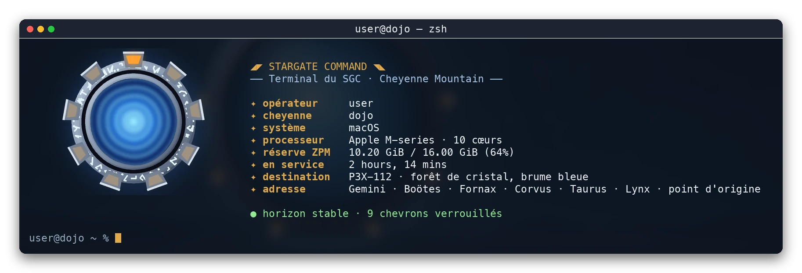
  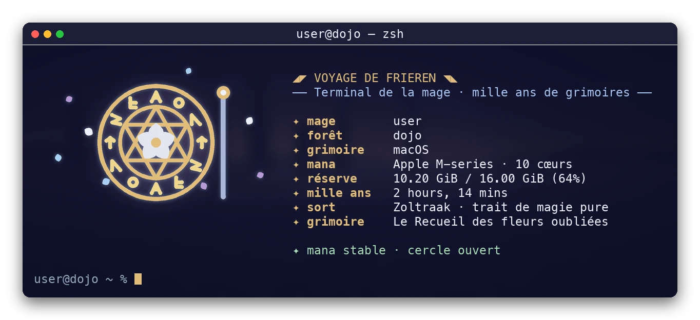
  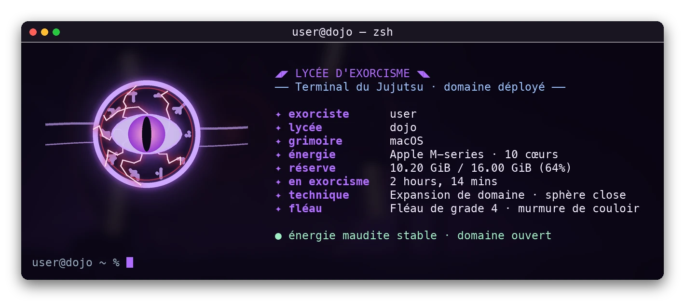
</p>

*The welcome header of three themes, with sample data. Rendered from the fastfetch output, in a Ghostty-style window.*

### Turn them on

- **Setup assistant**: in the **Thème** step (also reached from **Réglages…**), the **Terminal** section has one checkbox per target: **Appliquer aussi à Ghostty**, **Appliquer aussi à Terminal** and **Message d'accueil du terminal**. A checkbox is disabled when that app is not installed. The choice applies as soon as you tick the box.
- **Command line**:

  ```sh
  node ~/.config/claude-dojo/setup.js terminal status
  node ~/.config/claude-dojo/setup.js terminal apply '{"ghostty":true,"terminalApp":false,"welcome":true}'
  ```

  The keys are `ghostty`, `terminalApp` and `welcome`, and each is a boolean. A key left out keeps its saved value, and `terminal apply` with no argument applies the saved choice. `terminal status` prints the choice and the state of each part as JSON, without changing anything. Changing the theme with `set-theme` rewrites the parts that are active.

The choice is stored in the `terminal` key of [config.json](#configuration). Everything is off by default.

### What changes on your Mac

- **Ghostty**: a block marked `# claude-dojo terminal theme (managed)` in Ghostty's configuration file, which is `~/.config/ghostty/config` or the Application Support file, whichever exists. The block points to `~/.config/claude-dojo/terminal/ghostty.conf`, which holds the theme and the shaders.
- **zsh**: a block marked `# claude-dojo welcome (managed)` in `~/.zshrc` (or in `$ZDOTDIR/.zshrc`, with `ZDOTDIR` taken from the environment or from `~/.zshenv`). The block sources the header script only when that script exists. If Dojo cannot tell which `.zshrc` zsh reads, `terminal status` shows `welcome.effective: false` with a warning.
- **Terminal.app**: the profile is added to the window settings and set as the default and startup profile. The previous defaults are remembered, so removing the profile restores them. If Terminal is running, nothing is written: the `.terminal` file opens, and you confirm the import with a double-click.
- **Backups**: before Dojo changes your Ghostty configuration or your zsh configuration file, it saves a copy next to it as `<name>.bak-<timestamp>`.

### Header settings

Set these in your shell before the header runs, for example in `~/.zshrc` above the line that Dojo adds:

| Variable | Effect |
|---|---|
| `DOJO_WELCOME=off` | No header in new windows |
| `DOJO_ANIM=0` | Ghostty shows the still logo instead of the animation |

With Powerlevel10k's instant prompt, move Dojo's two lines (the marker and the line below it) above the instant prompt block at the top of `~/.zshrc`. Otherwise the header can be swallowed. Dojo leaves a block that is already up to date where you put it.

### Remove them

Untick the boxes, or run `node ~/.config/claude-dojo/setup.js terminal remove` to remove every part. `terminal remove '{"welcome":true}'` removes only the given ones. Dojo deletes its marked lines, the Terminal profile it imported and its generated files. The rest of your Ghostty configuration and `~/.zshrc` is left as it was. Uninstalling Dojo removes these parts too.

### Limits

- macOS only, like the rest of Dojo. The header works in zsh only, and only in Ghostty and Terminal.app. Other terminals show nothing.
- The shaders and the animated logo need Ghostty 1.x. The generated configuration was checked with `ghostty +validate-config` on Ghostty 1.3.1.
- fastfetch is optional. Install it with `brew install fastfetch`. Without it, the header is plain text with the same colours and the two lines.
- Terminal.app has no graphics protocol, so its logo is drawn with half-block characters, and it is not animated.
- Dojo does not change the Terminal profile while Terminal is running. See [What changes on your Mac](#what-changes-on-your-mac).

## Gallery

<p align="center">
  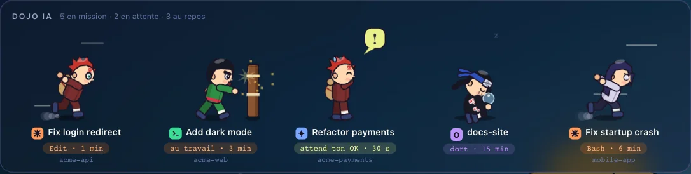
</p>

*The ninja view: one ninja per active session, showing its state (working, waiting, idle) and its project.*

<p align="center">
  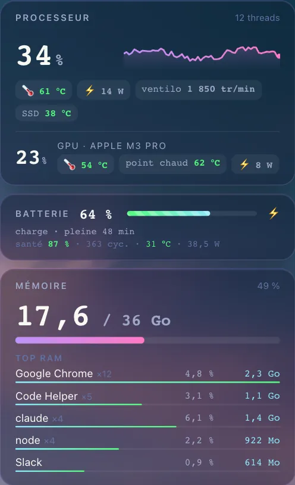
</p>

*The system panels: processor and GPU, battery, memory and top memory consumers.*

<p align="center">
  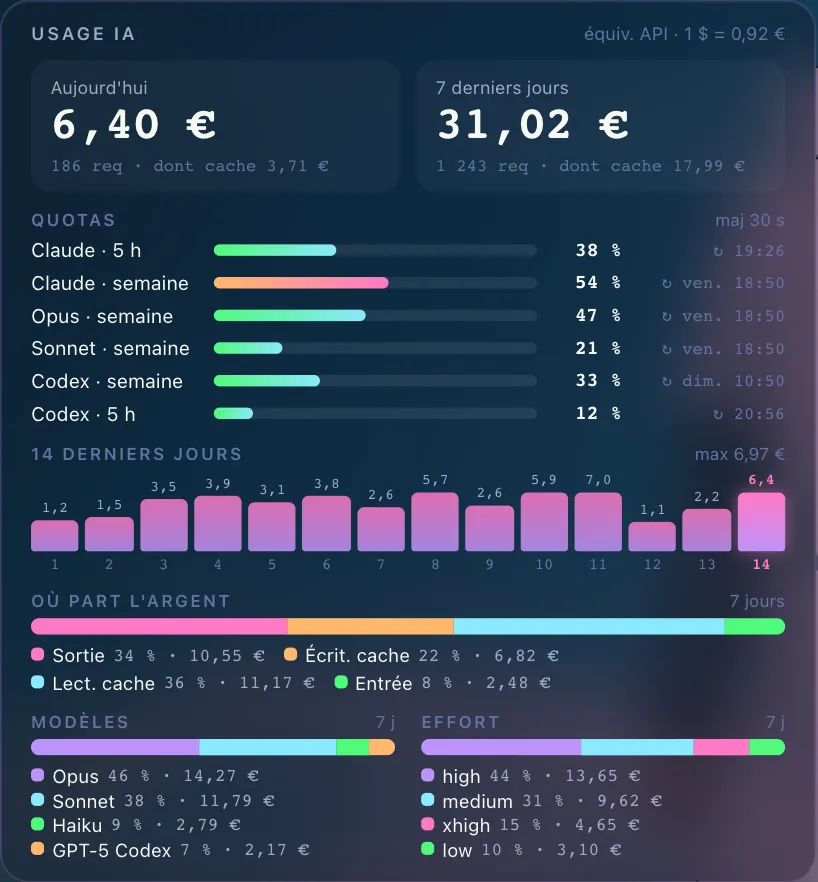
</p>

*The AI usage panel: estimated cost, Claude and Codex quotas, a 14-day chart, and a breakdown by model and effort level.*

## Requirements

- macOS 12.0 (Monterey) or later. The app in the DMG is a universal binary (Apple silicon and Intel), so nothing is compiled on your Mac.
- Node.js 18 or later. The assistant checks for it.
- For the [source install](#from-source-developers) only: Xcode Command Line Tools (`xcode-select --install`), which provide `swiftc`.

Optional tools:

| Tool | Purpose |
|---|---|
| Homebrew | Installs the optional tools below |
| `macmon` | Hardware sensors (temperatures, power) without sudo |
| `media-control` | Currently playing track |
| `gh` (GitHub CLI, logged in with `gh auth login`) | GitHub panel: pull requests, CI, contributions |
| Claude Code | Sessions and subscription quotas |

A missing optional tool simply hides its panel. No error is shown.

## What the installer does and asks

The source installer (`install.sh`):

1. copies the files from `src/` to `~/.config/claude-dojo` and runs `npm install` there (it installs `node-ical` for the calendar);
2. builds `DojoWallpaper.app` with `scripts/build-app.sh` (without the DMG), signs it ad hoc, and installs it in `~/Applications`;
3. writes two LaunchAgents, `io.github.claude-dojo.agent` (local agent and collector) and `io.github.claude-dojo.wallpaper` (wallpaper app), and loads them so they start at login;
4. merges the hooks, the `statusLine` and, if heavy-gate is enabled, the `VITEST_MAX_WORKERS` variable into `~/.claude/settings.json`, keeping everything else. Before any change, the file is copied to `settings.json.bak-<timestamp>`. Keys such as `model`, `effort`, `plugins` and `permissions` are never touched.

The hooks are registered for six events: `SessionStart`, `UserPromptSubmit`, `PreToolUse`, `Notification`, `Stop` and `SessionEnd`.

Without `--yes`, the installer asks:

- the city for the weather (Open-Meteo finds the coordinates and time zone);
- the GitHub owners whose personal repositories you want to follow;
- the project folders to scan for Git repositories;
- the ICS calendar URLs (optional);
- whether to enable heavy-gate (`y` / `N`);
- what to do if a `statusLine` already exists in `~/.claude/settings.json`;
- whether to install `macmon` and `media-control` with Homebrew, if they are missing;
- whether to start the Xcode Command Line Tools installation, if `swiftc` is missing.

The setup assistant asks the same questions, one step at a time, in a window.

If `~/.config/claude-dojo/config.json` already exists, it is kept as is and the configuration questions are skipped.

### Options

- `--yes`, `-y`: non-interactive mode. Answers come from the environment variables below, or from neutral defaults.
- `--no-launchd`: writes the LaunchAgents without loading them and without unloading anything in launchd. The Dojo then does not start automatically.
- `--help`: shows the help.

### Environment variables

| Variable | Purpose | Example |
|---|---|---|
| `DOJO_CITY` | City for the weather. Empty means no weather panel | `Paris` |
| `DOJO_LAT`, `DOJO_LON` | Coordinates, used when geocoding fails or to force them | `48.8566`, `2.3522` |
| `DOJO_TZ` | Weather time zone (IANA). Default: the system time zone | `Europe/Paris` |
| `DOJO_GITHUB_OWNERS` | Comma-separated GitHub owners. Empty disables the GitHub panel | `octocat` |
| `DOJO_PROJECT_ROOTS` | Comma-separated project folders. Default: `~/Projects` if it exists | `~/Projects,~/work` |
| `DOJO_CALENDARS` | Comma-separated ICS or webcal URLs | `https://calendar.example.com/feed.ics` |
| `DOJO_HEAVY_GATE` | `y` or `n` to enable or disable heavy-gate. Unset with `--yes` means no change | `y` |
| `DOJO_STATUSLINE` | `y` replaces an existing status line, `n` keeps it, `ask` asks (keeps it in non-interactive mode) | `n` |
| `DOJO_BREW` | `y` or `n` to install `macmon` and `media-control` with Homebrew | `y` |

## macOS permissions

- **Automation**: the first time you click a ninja, macOS asks for permission to control the terminal app through AppleScript (`osascript`), so the Dojo can bring the right window forward. The request may name `node` instead of DojoWallpaper, because the agent is a Node.js process that runs `osascript`. If you declined, enable it in System Settings > Privacy & Security > Automation, where the entry may also appear under `node`.
- **Keychain**: if `~/.claude/.credentials.json` does not exist, the collector reads your Claude Code login from the macOS Keychain item `Claude Code-credentials`, read-only. The first read can show a macOS prompt. Click **Always Allow** (« Toujours autoriser » in the French interface) to stop it from coming back, or decline it. If you decline, the Claude quota figures fall back to the status line data, and the quota section stays hidden when there is none.
- **Gatekeeper**: the app is ad hoc signed and not notarized. A copy downloaded as a DMG is blocked on its first launch (see [Install](#install), step 2). A copy compiled on your Mac by `install.sh` is not downloaded, so Gatekeeper normally does not block it.
- **Accessibility** (optional): only for the [window zone](#window-zone), which moves the windows of other apps. Dojo does nothing to a window without it. Enable DojoWallpaper in System Settings > Privacy & Security > Accessibility.
- **Local network**: the agent listens on `127.0.0.1` only. Other machines on your network cannot reach it.
- **Disk access**: no Full Disk Access is required. If your project folders are in protected locations such as Documents or Desktop, macOS may ask once for access to that folder.

## Configuration

The file is `~/.config/claude-dojo/config.json`. Every block is optional. Without a block, its panel stays hidden.

| Key | Purpose |
|---|---|
| `theme` | Id of the [theme](#themes): `naruto` (default), `stargate-sg1`, `demon-slayer`, `frieren`, `one-piece`, `my-hero-academia`, `jujutsu-kaisen` or `mushoku-tensei` |
| `background` | Path of a [custom background](#use-your-own-background), copied to `~/.config/claude-dojo/backgrounds/`. `null` (default) uses the background of the theme |
| `backgroundByTheme` | Background remembered for each theme: a theme id mapped to the path of a wallpaper, or to `theme` for the theme's own background. Written by the [gallery](#wallpapers) and by `wallpapers use` |
| `wallpapers.autoDownload` | `true` (default): the pack of the active theme is downloaded in the background when you switch theme, as described in [Automatic download](#automatic-download). `false` turns that off. `wallpapers sync <theme>` still works on request. This is not the `wallpapers` field of `theme.json` |
| `weather.name` | City label shown in the weather panel |
| `weather.lat`, `weather.lon` | City coordinates |
| `weather.timezone` | IANA time zone, for example `Europe/Paris` |
| `calendars` | List of ICS URLs (`https://` or `webcal://`) |
| `github.owners` | GitHub owners whose repositories you follow (pull requests, CI, contributions) |
| `projects.roots` | Folders to scan for Git repositories (`~` is accepted). Default: the common folders `Projects`, `Projets`, `Developer`, `Code`, `dev`, `src` and `repos` in your home folder, when they exist |
| `projects.onlyOwners` | `true` shows only repositories owned by `github.owners` |
| `sentry.token`, `sentry.org` | Sentry token and organization slug. Shows unresolved issues from the last 24 hours |
| `windowZone.enabled`, `windowZone.margin`, `windowZone.reserveTop`, `windowZone.exclude` | The optional [window zone](#window-zone). Off by default |
| `terminal` | Terminal parts to apply: `ghostty`, `terminalApp` and `welcome`, each `true` or `false` (default). See [Terminal themes](#terminal-themes) |

Example (placeholder values, replace them and delete the blocks you do not use):

```json
{
  "theme": "naruto",
  "weather": { "name": "Paris", "lat": 48.8566, "lon": 2.3522, "timezone": "Europe/Paris" },
  "calendars": ["https://calendar.example.com/feed.ics"],
  "github": { "owners": ["octocat"] },
  "projects": { "roots": ["~/Projects"], "onlyOwners": true },
  "sentry": { "token": "REPLACE_ME", "org": "my-organization" }
}
```

- The file is reloaded automatically. When it changes, the weather, calendar, Sentry and projects panels refresh without restarting the agent. A new `theme` or `background` is applied the same way.
- The installer never overwrites this file. It creates it with mode `0600` on first install.

**Privacy**: never publish this file, in a Git repository or anywhere else. It can contain private calendar URLs, which give access to your agenda, and tokens (Sentry).

## Data and network

### Local data

- **Claude Code sessions**: the hooks write the state of each session to `~/.claude/dojo/`. The status line writes the model, effort and quota data to `~/.claude/dojo/status/`.
- **Custom background**: a picture you choose with **Choose a background…** or `set-background` is copied to `~/.config/claude-dojo/backgrounds/`.
- **Wallpaper gallery**: the wallpapers you download are kept in `~/.config/claude-dojo/backgrounds/<theme>/`, readable by you only. Their sources are listed in `~/.config/claude-dojo/backgrounds/index.json`.
- **Transcripts**: the collector reads `~/.claude/projects` and `~/.codex/sessions` to compute usage and costs. The results are cached in `~/.config/claude-dojo/cache/`.
- **Claude quota**: read-only, from `~/.claude/.credentials.json` or, if that file does not exist, from the macOS Keychain item `Claude Code-credentials`. Nothing is copied or written elsewhere.
- **Costs**: estimated locally from the public API prices in the collector. They are converted to euros with the exchange rate below.

### Outgoing network requests

These are the only network destinations used by the collector and the wallpaper gallery:

| Destination | Frequency | What is sent |
|---|---|---|
| `api.open-meteo.com` (and `geocoding-api.open-meteo.com` during installation) | Weather every 15 min | City coordinates. The city name during installation |
| Configured ICS URLs | Calendar every 10 min | One request per URL. The URL often contains a secret |
| GitHub, through `gh` | Pull requests, CI and contributions every 5 min | Authenticated requests with your `gh` account |
| `api.anthropic.com` | Quota every 5 min | Your Claude Code OAuth token, to read subscription quotas. This endpoint is undocumented: if it fails, the panel falls back to the quota data from the status line |
| `api.frankfurter.app` | Every 6 hours | A USD to EUR exchange rate request. No personal data |
| `sentry.io` (only if configured) | Every 5 min | Your Sentry token |
| `wallhaven.cc`, `w.wallhaven.cc`, `th.wallhaven.cc` (see [Wallpapers](#wallpapers)) | Pack at launch and on theme change (unless `wallpapers.autoDownload` is `false`), one request per second. Gallery when you open or search it | Public requests: search terms, wallpaper ids and page numbers, with the `User-Agent: claude-dojo/<version>` header. No account, no API key |

Links clicked in the wallpaper open in your default browser.

## heavy-gate

heavy-gate is an optional `PreToolUse` hook (matcher `Bash`). It refuses to start a heavy command when the machine is already busy. The commands it checks are `test`, `check`, `lint`, `typecheck` and `build` scripts run through `npm`, `pnpm` or `yarn`; `vitest`, `playwright`, `tsc` and `eslint`, called directly or through `npx`, `bunx` or `pnpm exec`; `turbo run`; and `next build`. The gate counts the running `vitest`, `turbo run`, `tsc`, `eslint` and `next build` processes, and the total number of `node` processes. The refusal explains the reason, and Claude can retry later or run only the test files that changed.

Default limits:

- heavy processes running at once: `max(2, floor(cores / 3))`;
- `node` processes: 2 × RAM in GB, with a minimum of 2.

Settings:

- override the limits with `HEAVY_GATE_MAX` (heavy processes) and `HEAVY_GATE_MAX_NODE` (`node` processes);
- bypass the gate for one command with `HEAVY_GATE=off` in the command, or set `HEAVY_GATE=off` in the environment;
- fail-open: if the hook errors, the command goes through. The hook never stops Claude Code itself;
- the gate never kills a process. It only reads the process list with `ps`.

The installer and the assistant can also set `VITEST_MAX_WORKERS=2` in the `env` block of `~/.claude/settings.json`, unless the variable is already set. This limits the number of vitest workers. In the assistant it is a separate choice; in the source installer it follows heavy-gate.

## Uninstall

From the menu bar, choose **Désinstaller…**. Dojo removes its LaunchAgents, `~/Applications/DojoWallpaper.app` and its entries in `~/.claude/settings.json`, asks whether to delete `config.json` as well, and then quits. The uninstaller does not remove a copy in `/Applications`: move DojoWallpaper.app from Applications to the Trash yourself.

From the clone:

```sh
./uninstall.sh
```

Options:

- `--yes`, `-y`: no questions. Keeps `config.json`, the cache, the custom backgrounds and `~/.claude/dojo`;
- `--no-launchd`: does not touch launchd (the plists stay in place);
- `--purge`: also deletes `~/.config/claude-dojo` (configuration, cache and custom backgrounds) without asking;
- `--help`: shows the help.

The uninstaller stops and removes the LaunchAgents, deletes `~/Applications/DojoWallpaper.app`, and removes the Dojo entries from `~/.claude/settings.json` (hooks, status line, heavy-gate, and `VITEST_MAX_WORKERS` when it was set by the installer). Before changing `settings.json`, it saves a backup as `settings.json.bak-<timestamp>`. It asks separately before deleting the session state in `~/.claude/dojo`. Without `--purge`, your personal background stays in `~/.config/claude-dojo/backgrounds` after uninstalling. Nothing else is changed.

## Troubleshooting

**Logs** (all in `~/.config/claude-dojo/cache/`):

- `agent.log`: local agent;
- `wallpaper.log`: wallpaper app;
- `collector.log`: collector (weather, GitHub, quota, and so on).

**LaunchAgent status**:

```sh
launchctl print gui/$(id -u)/io.github.claude-dojo.agent
```

**Restart the agent or the wallpaper**:

```sh
launchctl kickstart -k gui/$(id -u)/io.github.claude-dojo.agent
launchctl kickstart -k gui/$(id -u)/io.github.claude-dojo.wallpaper
```

**Check the local server**: `http://localhost:7777/` shows the page, and `http://localhost:7777/stats` returns the data as JSON. If neither responds, read `agent.log`.

**Window zone does nothing**: check **Zone de travail** in the menu bar. If it says **Autorisation requise**, enable DojoWallpaper in System Settings > Privacy & Security > Accessibility (after an app update, remove the old entry first). See [Window zone](#window-zone).

**Common symptoms**:

- **The app does not open**: on a DMG install, Gatekeeper blocks the first launch. See [Install](#install), step 2.
- **A panel is missing**: its dependency or configuration key is missing (`gh` not logged in, `macmon` or `media-control` not installed, or no matching block in `config.json`).
- **The quota section is missing**: the Keychain item could not be read and no status line data is available yet (see macOS permissions).
- **Clicking a ninja does not bring the window forward**: the Automation permission was not granted (see macOS permissions). Window-precise focus works with Terminal, iTerm2 and Ghostty (the Ghostty AppleScript path needs Ghostty 1.3 or later). For other apps, the Dojo only brings the app forward. Codex Desktop sessions open directly in Codex.
- **The page does not update**: use Reload in the menu bar icon, or restart the agent with the command above.

## Development

- `src/setup.js` is the single source of truth for installing and uninstalling: the files, `config.json`, `settings.json` and the LaunchAgents. `install.sh`, `uninstall.sh` and the Swift assistant in `mac/` all call it, so the terminal and the app do the same thing.
- The themes are data in `src/themes/`, so adding one needs no change to the engine, as long as its fields are the ones listed in [Create a theme](#create-a-theme).
- The unit tests run with `node --test test/`. The geometry of the window zone (zone computation, coordinate conversion, fitting a window) is plain Swift in `mac/WindowZoneGeometry.swift`, tested by `scripts/test-swift.sh`. The Accessibility behavior itself cannot run in CI: see the manual checks in [CONTRIBUTING.md](CONTRIBUTING.md).
- CI runs the checks below, and also an install, reinstall and uninstall in a temporary `HOME`.

```sh
bash -n install.sh uninstall.sh
shellcheck -S warning install.sh uninstall.sh scripts/build-app.sh
for f in src/*.js scripts/*.cjs; do node --check "$f"; done
node --test test/
scripts/test-swift.sh
```

## Contributing

Contributions are welcome. Read [CONTRIBUTING.md](CONTRIBUTING.md) before opening a pull request, and follow the [CODE_OF_CONDUCT.md](CODE_OF_CONDUCT.md). To report a vulnerability, see [SECURITY.md](SECURITY.md). Do not use public issues for security reports.

## License

claude-dojo is released under the MIT License. See [LICENSE](LICENSE).

## Français

claude-dojo est un fond d'écran animé pour macOS : chaque session Claude Code active apparaît sous forme de ninja, entouré de panneaux système, GitHub, quotas et coûts d'usage IA.

Installation : téléchargez `ClaudeDojo-<version>.dmg` depuis la page [Releases](https://github.com/gtko/claude-dojo/releases), glissez DojoWallpaper.app dans Applications, puis ouvrez-le. Au premier lancement, Gatekeeper le bloque (app non notarisée) : Réglages Système › Confidentialité et sécurité › « Ouvrir quand même ». L'assistant guide ensuite l'installation. Prérequis : macOS 12 ou plus et Node.js 18 ou plus.

Installation depuis les sources (développeurs) : `git clone https://github.com/gtko/claude-dojo.git && cd claude-dojo && ./install.sh` (Node 18 ou plus et Xcode Command Line Tools requis).

Fonds d'écran : chaque thème propose une galerie de vrais fonds [Wallhaven](https://wallhaven.cc), en contenu SFW uniquement. Ils sont téléchargés en arrière-plan (sauf si `wallpapers.autoDownload` vaut `false` dans `config.json`) et restent sur votre Mac, avec la source de chaque image. Hors ligne et sans fond téléchargé, c'est le fond du thème qui s'affiche. Le menu **Fonds** permet de les changer.

Les sections en anglais détaillent tout : [Install](#install), [Requirements](#requirements), [What the installer does and asks](#what-the-installer-does-and-asks), [Configuration](#configuration), [Themes](#themes), [Wallpapers](#wallpapers), [Uninstall](#uninstall) et [Troubleshooting](#troubleshooting).

Zone de travail (facultative, désactivée par défaut) : garde les fenêtres de vos autres apps hors des panneaux du fond d'écran. Elle demande l'autorisation Accessibilité (Réglages Système › Confidentialité et sécurité › Accessibilité) ; sans elle, Dojo ne touche à aucune fenêtre. Activation : icône du menu › Zone de travail. Détails dans la section [Window zone](#window-zone).

Ne publiez jamais `~/.config/claude-dojo/config.json` : il peut contenir des URL de calendrier privées et des tokens.
